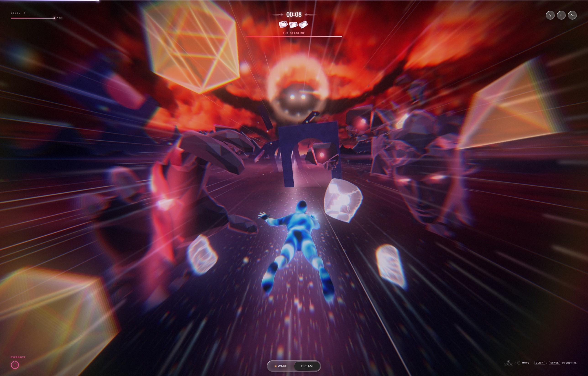

# Daiki Fujita Portfolio — Interactive 3D Web Experience

<div align="center">



**"Sites for waking. Worlds for dreaming."**  
*A portfolio to be read two ways — awake, guided through the work by a single shard of memory, or asleep, as a 3D dream you play to win the work back.*

[](https://nextjs.org/)
[](https://react.dev/)
[](https://threejs.org/)
[](https://tailwindcss.com/)
[](https://www.typescriptlang.org/)
[](https://lenis.darkroom.engineering/)
[](https://developer.mozilla.org/en-US/docs/Web/API/Web_Audio_API)
[](LICENSE)

[Explore Features](#-key-features--experiential-modes) • [Tech Stack](#-technical-architecture--stack) • [Quick Start](#-getting-started) • [Audio Engine](#-zero-asset-procedural-audio-engine) • [Controls](#-keyboard-shortcuts--controls) • [Credits](#-acknowledgments--credits)

</div>

---

## ✦ Overview

This project is a high-fidelity reconstruction and technical showcase of the award-winning portfolio of Tokyo-based web and interactive designer **Daiki Fujita** ([daikifujita.com](https://daikifujita.com)).

Rebuilt with **Next.js 16**, **React 19**, **Three.js**, and **Tailwind CSS v4**, the site demonstrates an editorial, sensory-driven web experience centered around a dual-reality narrative:
- **Awake Mode (`うつつモード`)**: A tactile, inertia-scrolled editorial showcase featuring a real-time 3D crystal shard, kinetic typography, dynamic blend-mode navigation, and interactive case study galleries.
- **Dream Mode (`夢モード`)**: An immersive 3D cosmos flight experience where users pilot through celestial space, seek out glowing memory nodes, and unlock portfolio projects interactively.
- **Retro Mode (`8-Bit Tokyo 1989`)**: A hidden arcade-style easter egg paying homage to vintage CRT monitors, scanline graphics, and chiptune sound synthesis.

---

## ✦ Key Features & Experiential Modes

### 1. 醒 Awake Mode (`うつつモード`)
The default editorial presentation combines high-fashion typography, minimalist geometry, and physical WebGL rendering.
- **Cinematic Preloader & Entry Sequence**: A full-screen preloader featuring an accelerating tabular numerical counter (`000` → `100`) gliding along the viewport's horizontal center axis, a kinetic dual-line `[ Enter ]` slot-roll button, and a physics-based skew curtain lift (`skewY`) that unveils the site on user interaction.
- **Interactive Shard of Memory**: A real-time 3D crystal rendered with `MeshPhysicalMaterial` featuring physical light transmission, refraction (`IOR 1.48`), custom normal and roughness maps, responsive mouse parallax, and dynamic rotation.
- **Difference Blend Header**: Fixed navigation with `mix-blend-mode: difference`, ensuring seamless contrast over both light paper surfaces and dark imagery.
- **Tokyo Real-Time Clock**: Synchronized live digital clock displaying Japan Standard Time (`Asia/Tokyo`).
- **Inertia Smooth Scrolling**: Fluid, momentum-based scrolling powered by **Lenis**.
- **Interactive Curated Case Studies**:
  - `Portfolio v2` (2026) — The dual-reality 3D interactive portfolio.
  - `INCEPTURE` (2025) — Poetic gallery site exploring nightmares and emotional graphic works.
  - `Portfolio v1` (2025) — Abstract particle visualization of problem solving.
- **Accolades & Certificate Showcase**: Interactive awards roster detailing honors from **The FWA**, **CSS Design Awards**, and **CSS Winner**, complete with instant preview overlays.

---

### 2. 夢 Dream Mode (`夢モード`)
Accessed via the `#dream-mode` hash, the header pill, or by engaging the floating shard.
- **Full-Screen 3D Cosmos Sandbox**: Rendered with Three.js using dynamic atmospheric fog (`FogExp2`), cosmic directional lighting, and ACES Filmic tone mapping.
- **6-DOF Flight Navigation**: Pilot through space using mouse tracking, click-and-drag rotation, or classic keyboard navigation (`W`, `A`, `S`, `D` / Arrow keys).
- **Celestial Memory Nodes**: Floating memory crystals scattered across 3D coordinates. Approaching nodes triggers proximity lighting, cosmic pulse effects, and collects shards.
- **HUD Flight Deck**: Real-time celestial coordinate readouts (`X`, `Y`, `Z`), memory counter, status alerts, and sound controls.
- **Custom 3D Assets**: Seamlessly loads Draco/GLTF models (`dream_model.glb`, `figure.glb`) into the scene graph.

---

### 3. 👾 8-Bit Retro Mode (`TOKYO_1989`)
A hidden arcade tribute triggered via hotkey or the bottom floating control pill.
- **Vintage CRT Shading**: Procedural scanline overlay, barrel distortion vignette, and CRT phosphor glow.
- **Retro Mini-Quest**: Steer the 8-bit avatar across the screen, collect memory pixels, score points, and trigger chiptune arpeggios.
- **Toggle**: Press <kbd>Shift</kbd> + <kbd>R</kbd> or <kbd>8</kbd> anywhere on the site.

---

### 4. 🔊 Zero-Asset Procedural Audio Engine
Built entirely with the native **Web Audio API** (`lib/soundEngine.ts`), requiring **0 MB** of external audio asset downloads.
- **Algorithmic Reverb**: Generates synthetic stereo impulse response buffers with exponential decay (`ConvolverNode`) for ethereal spatial acoustics.
- **Sub-Bass Ambient Drone**: Dual harmonic sine oscillators tuned to A1 (55 Hz / 110 Hz) passing through a dynamic 240 Hz lowpass filter.
- **Procedural Sound FX**:
  - *Click / Pop*: Micro-enveloped triangle burst.
  - *Frequency Sweep*: Exponential pitch ascent with resonant bandpass filtering.
  - *Celestial Shimmer*: Multi-voice pentatonic overtone arpeggio.
  - *Collection Chords*: Ethereal triad synthesizer on memory shard discovery.
- **State Persistence**: Remembers audio preferences across browser sessions via `localStorage`.

---

## ✦ Technical Architecture & Stack

```
daikifujita-clone/
├── app/
│   ├── globals.css           # Tailwind CSS v4 directives, custom font imports & reset
│   ├── layout.tsx            # Next.js RootLayout with OpenGraph, SEO & viewport config
│   ├── not-found.tsx         # Custom 404 handler
│   └── page.tsx              # Root controller orchestrating Awake, Dream & Retro states
├── components/
│   ├── AboutSection.tsx      # Design philosophy, client capabilities & honors list
│   ├── AwakeView.jsx         # Full-fidelity editorial presentation with Framer motion curves
│   ├── ContactSection.tsx    # Footer with email contact, Tokyo timezone clock & links
│   ├── DreamShift.tsx        # 3D interactive cosmos flight canvas & memory collection game
│   ├── Header.tsx            # Sticky header with mix-blend-mode navigation
│   ├── Hero.tsx              # Split typography hero with embedded 3D Shard
│   ├── LocalClock.tsx        # Live time format component with Intl.DateTimeFormat
│   ├── Preloader.tsx         # Theatrical loader with gliding 000-100 count, kinetic Enter roll & skew curtain lift
│   ├── RetroMode.tsx         # 8-bit CRT arcade easter egg experience
│   ├── ShardOfMemory.tsx     # Three.js physical transmission ice crystal component
│   ├── SmoothScroll.tsx      # Lenis smooth scroll provider
│   └── WorksSection.tsx      # Horizontal work gallery with modal lightbox
├── lib/
│   └── soundEngine.ts        # Zero-asset procedural Web Audio synthesizer engine
├── public/
│   ├── images/               # High-resolution project photography & award badges
│   ├── models/               # 3D assets (tb_block.glb, dream_model.glb, figure.glb)
│   └── textures/             # Normal and roughness maps for WebGL materials
├── package.json              # Project dependencies and build scripts
├── postcss.config.mjs        # PostCSS configuration for Tailwind v4
└── tsconfig.json             # TypeScript compiler settings & path aliases (@/*)
```

### Core Technologies

| Category | Technology | Version | Purpose |
| :--- | :--- | :--- | :--- |
| **Framework** | [Next.js](https://nextjs.org/) (App Router) | `16.4+` | Modern React server & client architecture, hybrid rendering |
| **UI Library** | [React](https://react.dev/) | `19.3+` | Next-generation React concurrency and hooks |
| **3D & Graphics** | [Three.js](https://threejs.org/) | `0.187+` | WebGL scene graph, GLTF loading, custom physical materials |
| **Styling** | [Tailwind CSS](https://tailwindcss.com/) | `v4.3+` | Engine with `@tailwindcss/postcss` and CSS variables |
| **Animation** | [Framer Motion](https://www.framer.com/motion/) | `14.9+` | Declarative transitions, stagger reveals, spring physics |
| **Smooth Scroll**| [Lenis](https://lenis.darkroom.engineering/) | `1.3+` | Momentum-based inertia viewport scrolling |
| **Audio** | [Web Audio API](https://developer.mozilla.org/en-US/docs/Web/API/Web_Audio_API) | Native | Algorithmic reverb, drones, and procedural sound effects |
| **Icons** | [Lucide React](https://lucide.dev/) | `1.16+` | Minimal vector iconography |
| **Language** | [TypeScript](https://www.typescriptlang.org/) | `5.8+` | End-to-end type safety |

---

## ✦ Getting Started

### Prerequisites

Ensure you have **Node.js 20+** or **Bun** installed on your system.

```bash
# Check Node version
node -v   # v20.0.0 or higher

# Or check Bun version
bun -v    # 1.0.0 or higher
```

### Installation

1. **Clone the repository**:
   ```bash
   git clone https://github.com/your-username/daikifujita-clone.git
   cd daikifujita-clone
   ```

2. **Install dependencies**:
   ```bash
   # Using Bun (recommended)
   bun install

   # Or using npm
   npm install

   # Or using pnpm
   pnpm install
   ```

3. **Start the local development server**:
   ```bash
   bun dev
   # or: npm run dev
   ```

4. **Open in browser**:
   Navigate to [http://localhost:3000](http://localhost:3000) to view the project.

---

## ✦ Build & Deployment

### Production Build

Create an optimized production bundle:

```bash
# Build production bundle
bun run build
# or: npm run build

# Start production server
bun run start
# or: npm run start
```

### Deploy to Vercel

The easiest way to deploy this Next.js project is using the [Vercel Platform](https://vercel.com):

[](https://vercel.com/new)

```bash
npm install -g vercel
vercel
```

---

## ✦ Keyboard Shortcuts & Controls

| Shortcut / Input | Scope | Action |
| :--- | :--- | :--- |
| <kbd>Shift</kbd> + <kbd>R</kbd> | Anywhere | Toggle 8-Bit Retro CRT Mode |
| <kbd>8</kbd> | Anywhere | Toggle 8-Bit Retro CRT Mode |
| <kbd>Esc</kbd> | Dream / Retro | Exit to Awake Mode |
| `W` / `A` / `S` / `D` or `Arrow Keys` | Dream Mode | 3D Flight Camera Navigation |
| `Mouse Drag` / `Touch` | Dream Mode | Orbital & Pitch Look Camera |
| `Left / Right Arrows` | Retro Mode | Move 8-Bit Player |
| <kbd>Space</kbd> / <kbd>Enter</kbd> | Retro Mode | Collect Memory Pixel (+100 EXP) |
| `#dream-mode` | URL Hash | Deep-link directly into 3D Dream Mode |

---

## ✦ Performance & Graphics Optimizations

- **Adaptive Pixel Ratio**: Caps `renderer.setPixelRatio` at `Math.min(window.devicePixelRatio, 2)` to eliminate thermal throttling and GPU spikes on 4K/Retina displays.
- **Hardware-Accelerated Blending**: Utilizes GPU compositor layers for `mix-blend-mode: difference` navigation and noise turbulences.
- **Transmission Shaders**: MeshPhysicalMaterial is tuned with `ior: 1.48` and pre-warmed roughness/normal textures for high framerates (60+ FPS).
- **Zero Audio Network Overhead**: Procedural audio generation eliminates audio asset latency and cuts down initial page bundle transfer.
- **Font Optimization**: Preconnected Google Fonts (`Inter Tight`, `Instrument Serif`, `DM Mono`, `Noto Sans JP`) with `display=swap`.

---

## ✦ Acknowledgments & Credits

- **Original Design & Art Direction**: [Daiki Fujita](https://daikifujita.com) ([@da_san333](https://x.com/da_san333)) — Tokyo-based Web & Interactive Designer.
- **Awards Won by Original Site**:
  - 🏆 **The FWA**: FWA of the Day
  - 🏆 **CSS Winner**: Site of the Month & Site of the Day
  - 🏆 **CSS Design Awards**: Special Kudos, Best UI, Best UX, Best Innovation
- **3D & Creative Coding Ecosystem**: Three.js, Lenis by Studio Freight / Darkroom, Framer Motion.

---

## ✦ License

This project is created for educational, research, and technical demonstration purposes under the [MIT License](LICENSE).  
*Original designs, brand identities, and photographic assets belong to their respective copyright holders.*
